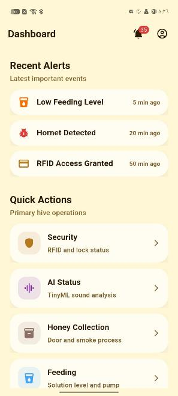
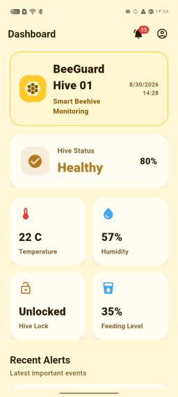
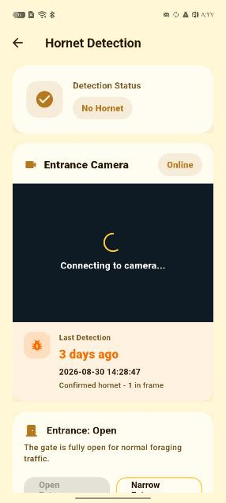
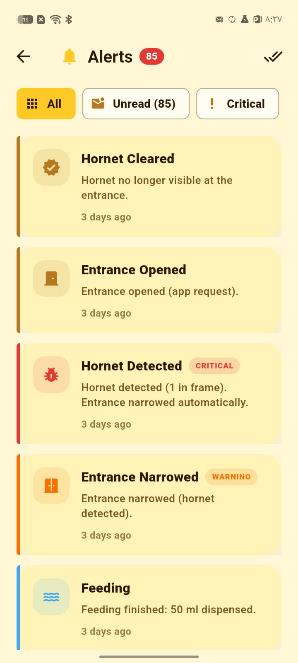

# 🐝 BeeGuard – Smart Beehive Monitoring System

**Graduation project – Computer Engineering, An-Najah National University**

BeeGuard is an IoT + AI system that watches over beehives: ESP32 boards inside and around the hive measure temperature, humidity and sound, an ESP32-CAM detects hornets with an on-device ML model, and a Flutter app shows everything live and sends alerts to the beekeeper.

<p align="center">
  
  
  
  
</p>

## How it works

```
 ┌──────────────────┐   ESP-NOW   ┌────────────────────────┐   Firebase   ┌──────────────┐
 │ Hive monitor      │ ──────────► │ Main controller (ESP32) │ ───────────► │ Flutter app  │
 │ DHT11 + INMP441   │             │ fans · feeding · alarms │  Realtime DB │ (Android/iOS)│
 └──────────────────┘             └────────────────────────┘              └──────────────┘
 ┌──────────────────┐   ESP-NOW          ▲
 │ ESP32-CAM         │ ──────────────────┘
 │ hornet detection  │  (Edge Impulse / TensorFlow Lite model)
 └──────────────────┘
```

## Features

- **Live monitoring** – temperature, humidity and hive sound in real time
- **Hornet detection** – on-device image classification on the ESP32-CAM
- **Hive control** – fans, feeding and security from the app
- **Alerts & notifications** – abnormal readings or detected threats
- **Statistics & weather** – history charts and local weather for the apiary

## Repository layout

| Path | What's inside |
|------|---------------|
| `lib/` | Flutter app – 15 screens (dashboard, live monitoring, hornet detection, control, statistics, weather …) |
| `firmware/BeeGuard_Main_Controller` | Main ESP32 controller (ESP-NOW hub + Firebase uplink) |
| `firmware/BEE_HIVE_MONITOR` | In-hive sensor board (DHT11 + INMP441 microphone) |
| `firmware/esp32cam_hive_guard` | ESP32-CAM with the hornet classifier |
| `ei-bee-classifier-*` | Trained Edge Impulse / TensorFlow Lite models |
| `docs/` | Project website and app screenshots |
| `SETUP_V5.md` | Setup & calibration guide (Arabic) |

## Tech stack

Flutter · Dart · Firebase Realtime Database · ESP32 / ESP32-CAM (Arduino C++) · ESP-NOW · Edge Impulse · TensorFlow Lite

## Run the app

```bash
flutter pub get
flutter run
```

Flash the three sketches in `firmware/` with the Arduino IDE (ESP32 board package). All boards must be on the same Wi-Fi channel – see `SETUP_V5.md`.
